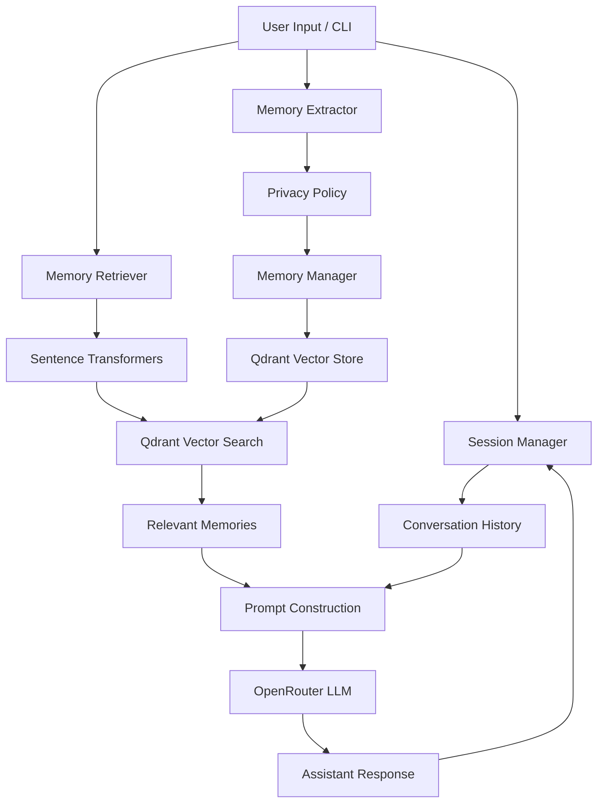

# Long-Term Memory Chatbot

A Python-based conversational AI chatbot that uses long-term memory to personalize responses across multiple sessions. It combines an LLM accessed through OpenRouter, local sentence embeddings, and a persistent Qdrant vector database to store and retrieve relevant user information.

Unlike a chatbot that relies only on the current conversation history, this project separates short-term conversational context from persistent semantic memories.

## Features

- **Conversational AI:** Generate responses using an LLM through OpenRouter.
- **Persistent session history:** Save conversations locally and resume previous sessions.
- **Long-term memory extraction:** Identify potentially useful facts, preferences, interests, skills, and goals from user messages.
- **Semantic memory retrieval:** Retrieve relevant stored memories using vector similarity search.
- **Memory management:** Create and update memories, reduce duplicates, and flag potentially conflicting information for review.
- **Privacy-aware storage:** Apply a memory policy before storing extracted information.
- **Memory controls:** Inspect stored memories, delete individual memories, clear all memories for a user, and change the memory policy.
- **Command-line interface:** Interact with the chatbot directly from a terminal without requiring a frontend.

## Technology Stack

| Technology | Purpose |
|---|---|
| Python | Application logic and orchestration |
| OpenRouter | LLM access for response generation and memory extraction |
| Sentence Transformers | Generate semantic embeddings locally |
| `all-MiniLM-L6-v2` | Default embedding model producing 384-dimensional vectors |
| Qdrant Client | Local vector storage and similarity search |
| JSON | Persistent session history |
| `python-dotenv` | Load environment variables from `.env` |

## Architecture

The application combines two types of memory:

- **Short-term memory:** The conversation history associated with the current session.
- **Long-term memory:** Selected user information stored as vectors with metadata in Qdrant.

### Processing workflow

1. The user submits a message through the CLI.
2. The embedding model converts the message into a vector.
3. Qdrant searches for relevant memories associated with the user.
4. Retrieved memories are added to the system context alongside the current session history.
5. OpenRouter generates the assistant's response.
6. The conversation is saved to the session's persistent history.
7. The memory extractor identifies candidate facts from the user's message.
8. The privacy policy screens candidates before the memory manager creates, updates, or flags them.
9. Approved memories are embedded and stored in Qdrant for future retrieval.

### Architecture diagram



## Project Structure

```text
LongTermMemory_Chatbot/
├── main.py
├── config.py
├── requirements.txt
├── .env
├── .gitignore
│
├── llm/
│   ├── __init__.py
│   └── openrouter_client.py
│
├── embeddings/
│   ├── __init__.py
│   └── embedding_model.py
│
├── memory/
│   ├── __init__.py
│   ├── memory_extractor.py
│   ├── memory_manager.py
│   ├── memory_retriever.py
│   ├── privacy_policy.py
│   └── qdrant_store.py
│
├── session/
│   ├── __init__.py
│   └── session_manager.py
│
├── data/
│   └── sessions/
│
├── qdrant_data/
│
├── test_embeddings.py
├── test_memory_extractor.py
├── test_memory_manager.py
├── test_memory_retriever.py
├── test_privacy_policy.py
└── test_qdrant.py
```

The `data/sessions/` and `qdrant_data/` directories hold local persistent data and are generated or populated during execution.

## Installation and Setup

### Prerequisites

- Python installed on your system.
- An OpenRouter API key.
- Internet access for API requests and the initial embedding-model download.

### 1. Clone the repository

```bash
git clone https://github.com/VedantBarhate/LongTermMemory_Chatbot.git
cd LongTermMemory_Chatbot
```

### 2. Create a virtual environment

**Windows:**

```powershell
python -m venv .venv
.venv\Scripts\activate
```

**Linux / macOS:**

```bash
python -m venv .venv
source .venv/bin/activate
```

### 3. Install dependencies

```bash
python -m pip install --upgrade pip
pip install -r requirements.txt
```

### 4. Configure the API key

Create a `.env` file in the project root:

```dotenv
OPENROUTER_API_KEY=your_openrouter_api_key
```

Replace the placeholder with your actual API key.

The application loads the key through `python-dotenv`. The configured default model is `openrouter/free`, as specified in `config.py`.

**Security:** Never commit your real API key to GitHub. The `.env` file is included in `.gitignore`.

### 5. Run the chatbot

```bash
python main.py
```

The application initializes the embedding model and local Qdrant storage before displaying the command-line interface.

On the first run, Sentence Transformers may download the embedding model. Later runs normally reuse the locally cached files, although the model still needs to be loaded into memory.

## CLI Commands

| Command | Description |
|---|---|
| `/new` | Create a new conversation session |
| `/sessions` | List available sessions |
| `/use <session_id>` | Switch to an existing session |
| `/current` | Display the active session |
| `/history` | Display the current session's messages |
| `/delete <session_id>` | Delete a session |
| `/memories` | List stored long-term memories |
| `/forget <memory_id>` | Delete an individual memory |
| `/clear_memory` | Request confirmation and delete all long-term memories for the configured user |
| `/memory_mode AUTO` | Automatically approve candidates that pass the privacy policy |
| `/memory_mode ASK` | Request confirmation before storing each eligible candidate |
| `/memory_mode DISABLED` | Prevent new memory candidates from being approved for storage |
| `/exit` | Exit the chatbot |

Memory modes are runtime settings in the current implementation and may reset when the application restarts.

## Example Usage

### 1. Store a preference

```text
You: I prefer Python over Java for my projects.
Assistant: [Response generated by the LLM]
```

The memory extractor evaluates whether the message contains useful information to remember. If the candidate passes the privacy policy, the memory manager stores or updates it.

### 2. Inspect memories

```text
You: /memories
```

The CLI displays stored memory IDs, types, text, and importance values.

### 3. Test cross-session recall

```text
You: /new
You: Which programming language do I prefer for my projects?
```

If the preference was stored successfully and retrieved as relevant, it can be supplied to the LLM to personalize the response.

## Running the Tests

The repository includes individual scripts for testing the major components.

Run them from the project root:

```bash
python test_embeddings.py
python test_qdrant.py
python test_memory_extractor.py
python test_privacy_policy.py
python test_memory_manager.py
python test_memory_retriever.py
```

Some tests call the external LLM or initialize the embedding model and local vector database. Ensure the API key is configured and no other process is holding the same local Qdrant storage directory.

These scripts are component-level tests. Their output should be reviewed to determine whether each component behaves as expected; successful execution alone does not establish comprehensive correctness.

## Design Considerations

### Why use semantic embeddings?

Keyword matching may fail when a user asks about a previously stored fact using different wording. Embeddings represent text as numerical vectors, allowing Qdrant to retrieve semantically similar memories.

### Why extract facts instead of storing every message?

Raw conversational messages contain greetings, temporary requests, and irrelevant details. Extracting candidate facts allows the application to store selected information rather than embedding every message indiscriminately.

### Why separate session history and long-term memory?

Session history preserves the dialogue within a conversation. Long-term memory stores selected information that can be retrieved across sessions without requiring the entire historical conversation to be included in every prompt.

### Why use a local Qdrant database?

The local Qdrant client persists vector records on disk and supports similarity search without requiring a separately hosted Qdrant server. However, local storage must not be opened concurrently by multiple independent Qdrant client instances.

## Limitations and Privacy Considerations

- **LLM dependency:** Response generation and memory extraction depend on OpenRouter and the availability and behavior of the configured model.
- **Additional latency:** Memory extraction may require an additional LLM request after a response has been generated.
- **Extraction reliability:** The extractor may miss useful facts or produce malformed structured output.
- **Retrieval quality:** Semantic similarity does not guarantee that a retrieved memory is relevant or correct.
- **Conflict resolution:** Similarity thresholds can identify possible duplicates, but they cannot reliably determine whether two statements contradict each other.
- **Privacy screening:** The privacy policy uses programmatic checks and is not guaranteed to identify every sensitive detail or secret.
- **External processing:** User messages and relevant context sent to OpenRouter are subject to the selected provider's applicable data-handling policies.
- **Deletion scope:** Deleting a long-term memory does not automatically remove related content from session-history files or external provider records.
- **Memory modes:** Disabling new memory storage does not, by itself, erase existing memories, disable retrieval, or prevent messages from being sent to OpenRouter.
- **Single configured user:** The current CLI uses a fixed `USER_ID`. It is not a complete authentication or multi-user access-control system.

## Future Improvements

Potential extensions include:

- Automated evaluation of memory extraction and retrieval quality.
- Persistent user-configurable privacy settings.
- More robust structured output validation and extraction retries.
- Improved contradiction detection and memory updates.
- Explicit controls for disabling retrieval and managing session-data deletion.
- Automated integration tests and repeatable demonstration scenarios.

